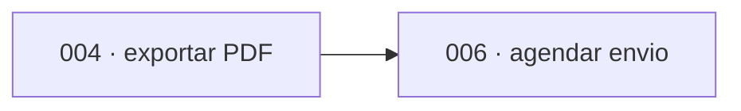

# 🛣️ Roadmap

Mantido pelo Arquiteto. Cada spec aparece em exatamente uma seção; ideias de origem apontam para [`IDEIAS.md`](IDEIAS.md). A ordem de **Próximas** é decisão sua — o Arquiteto sugere, você confirma.

## 🚧 Em execução

| Spec | Ideias | Onde roda | Desde |
|---|---|---|---|

## 🛣️ Próximas, em ordem

| # | Spec | Ideias | Depende de | Solução open source |
|---|---|---|---|---|

<!-- Com duas ou mais próximas dependentes entre si, o Arquiteto desenha aqui:

-->

## 🗺️ Mapeadas, sem prioridade

| Spec | Ideias | Em uma frase |
|---|---|---|

## ✅ Implementadas

| Spec | Ideias | Entrega | Data |
|---|---|---|---|

## 🗑️ Descartadas

| Ideia | Motivo | Data |
|---|---|---|
