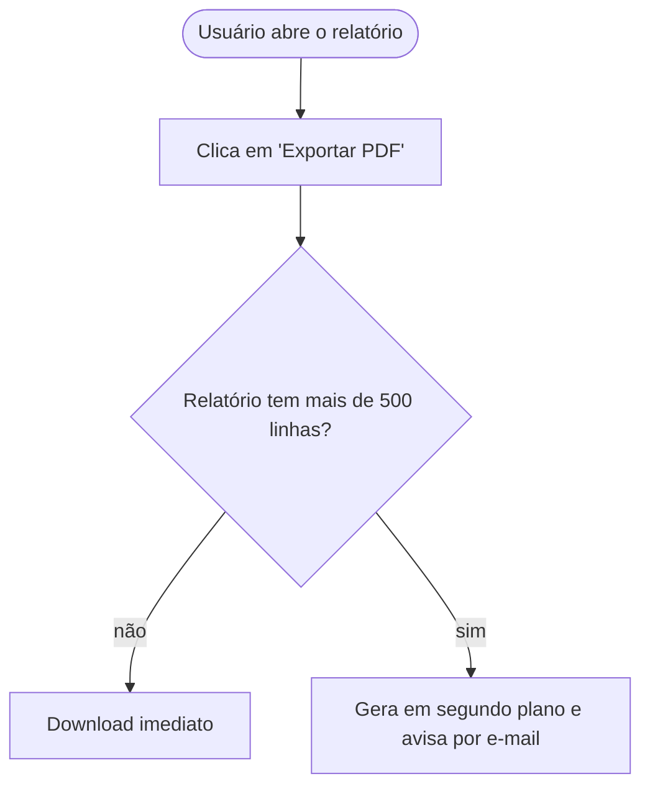

# Modelo de `spec.md`

Para o **Arquiteto**, na hora de escrever. A spec tem dois leitores: o usuário, que precisa entender em dois minutos o que vai ser construído, e o executor, que precisa derivar um pronto binário sem inventar nada. As seções de cima são para o primeiro; as de baixo, para o segundo.

## Regras de leitura fácil

- **Tabela e lista antes de parágrafo.** Frase curta. Uma ideia por linha.
- **Diagrama em Mermaid**, que renderiza no GitHub, no GitLab e nas IDEs. Sintaxe simples: `flowchart` e `sequenceDiagram`, rótulo com parêntese ou acento entre aspas, até ~12 nós. Diagrama que não renderiza é pior que nenhum.
- **O diagrama não substitui o texto.** Todo passo do fluxo também está numerado embaixo — executor e `grep` leem texto.
- Linguagem do usuário em "Problema" e "Fluxo de uso"; nome técnico só de "Contratos" para baixo.
- Seção que não se aplica: escreva `Não se aplica — <motivo>` em vez de apagar. Ausência é ambígua.

## Esqueleto

````md
# NNN — <título curto>

> **Em uma frase:** <o que muda para quem usa>
>
> **Ideias de origem:** IDEIAS #3, #7 · **Domínio:** <auth, billing…> · **Status:** mapeada | em execução

## 🎯 Problema e resultado

| Hoje | Quando estiver pronto |
|---|---|
| <dor concreta> | <resultado observável> |

## 👤 Fluxo de uso



1. O usuário abre o relatório e clica em **Exportar PDF**.
2. Até 500 linhas: download imediato.
3. Acima disso: geração em segundo plano e aviso por e-mail com o link.

## ✅ Critérios de aceite

- [ ] <binário e verificável: quem testa sabe dizer sim ou não>

## 🧭 Fronteira

| Dentro | Fora (e por quê) |
|---|---|
| | |

## 🔌 Contratos de dado e interface

Entrada, saída, schema, rota, nomes de campo, protocolo, comportamento de erro. Mais de dois atores conversando: `sequenceDiagram`. Campos: tabela com nome, tipo, obrigatório, exemplo.

## ⚠️ Casos de borda

| Situação | Comportamento esperado |
|---|---|

## 🧱 Stack e convenções do workspace

O que você descobriu no repositório e o executor não deve redescobrir: versões, bibliotecas em uso, padrão de teste, gates do CI.

## 📦 Soluções open source avaliadas

| Projeto | O que resolve | Licença | Última release | Adoção | Veredito |
|---|---|---|---|---|---|
| [nome](link) | | | | | adotar · adaptar · inspirar · descartar |

**Decisão:** <adotar X / adaptar Y / construir> — <porquê, em uma linha>. Pesquisa não feita: diga o motivo aqui.

## 🧾 Decisões

| Decisão | Alternativas rejeitadas | Porquê | Custo de reverter |
|---|---|---|---|

## ❓ Em aberto

| Ponto | Recomendação do Arquiteto | Bloqueia execução? |
|---|---|---|

## 🔬 Evidência de validação

O que precisa voltar como prova de que cada critério de aceite passou.

## 🔗 Dependências e handoff

Specs ou sistemas de que esta depende, e a condição para começar.
````

**Em aberto** só existe em spec mapeada. Antes de a execução começar, ela tem que estar vazia: o Arquiteto da feature fecha cada ponto com o usuário ao abrir a feature, e o Maestro devolve spec que chegue com ponto aberto.
